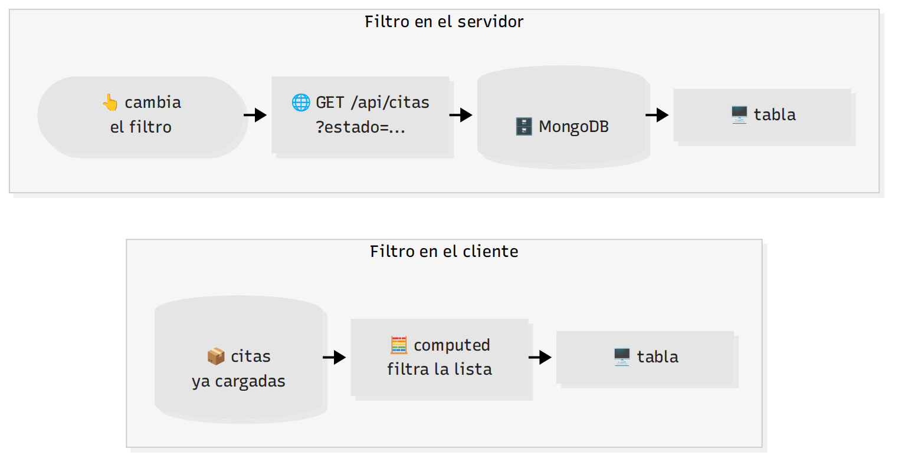

# Listas, filtros y búsqueda

[← Índice](README.md) · [Siguiente: formularios y campos →](02-formularios-y-campos.md)

Todo lo que pueden pedirte sobre **qué se ve en una tabla**: filtrar, buscar, ordenar, paginar y contar. Está pensado para no salir de esta página: cada concepto se explica donde se usa, con un enlace por si quieres la lección completa.

## En esta página

1. [Cliente o servidor](#1-cliente-o-servidor)
2. [Lo que necesitas saber](#2-lo-que-necesitas-saber)
3. [Las piezas del proyecto](#3-las-piezas-del-proyecto)
4. [Filtrar por estado y por doctor](#4-filtrar-por-estado-y-por-doctor)
5. [Buscador de texto](#5-buscador-de-texto)
6. [Rango de fechas](#6-rango-de-fechas)
7. [Filtrar por especialidad a través del doctor](#7-filtrar-por-especialidad-a-través-del-doctor)
8. [Ordenar y paginar](#8-ordenar-y-paginar)
9. [Limpiar filtros y contar resultados](#9-limpiar-filtros-y-contar-resultados)
10. [Hacerlo en el servidor](#10-hacerlo-en-el-servidor)
11. [Si te piden esto, mira aquí](#11-si-te-piden-esto-mira-aquí)
12. [Fallos que quitan puntos](#12-fallos-que-quitan-puntos)
13. [Recetas cortas y lecciones](#13-recetas-cortas-y-lecciones)

## 1. Cliente o servidor

Hay dos sitios donde filtrar y el enunciado casi nunca dice cuál. Decídelo tú:



| | En el cliente | En el servidor |
|---|---|---|
| Cómo | Un `computed` filtra la lista que ya tienes | Se vuelve a pedir la lista con `?estado=...` |
| Velocidad | Instantáneo, sin red | Una petición por cambio |
| Hace falta tocar el backend | No | Sí, y reiniciarlo |
| Con muchos datos | Se vuelve lento: bajas todo | Bien: solo bajas lo que se ve |
| El enunciado dice | «filtro», «buscador» | «el backend admite `?estado=`», «`curl` devuelve solo...» |

Regla práctica: si el enunciado habla de `curl`, de parámetros de la URL o de que «el backend» filtre, es servidor. Si habla de la pantalla, cliente.

## 2. Lo que necesitas saber

**`ref`**: una caja vigilada. Guarda un valor, y si cambia, Vue repinta lo que lo usa. En el script se lee y se escribe con `.value`; en el template, sin `.value`. Aquí guarda lo que eligió el usuario en un filtro. → `03_lecciones/01_reactividad.md §2`

**`v-model`**: ata un campo del formulario a un `ref` en los dos sentidos. Escribes en el campo y cambia el `ref`; cambias el `ref` y cambia el campo. En un `<select>`, el valor es el `:value` de la opción elegida, no el texto que se ve. → `03_lecciones/vue/02_v_model.md`

**`computed`**: un dato que sale de otros. No lo asignas; escribes la fórmula y Vue la recalcula cuando cambia algo de lo que lee. Es la pieza de todos los filtros del cliente. → `03_lecciones/vue/07_computed.md`

**`filter` e `includes`**: `lista.filter((x) => condición)` devuelve un array nuevo con los elementos que cumplen la condición, sin tocar el original. `texto.includes("ab")` dice si el texto contiene «ab». Con una cadena vacía, `includes("")` es siempre `true`: por eso un buscador vacío deja pasar todo.

**Parámetros de la URL** (`?estado=pendente&fecha=2026-11-19`): lo que va detrás del `?`. En Express se leen en `req.query`; en axios se mandan con `{ params: { estado: "pendente" } }`. → `03_lecciones/03_crud_api_rest.md §3 y §5`

**Orden de las condiciones**: `a && b` exige las dos. Un filtro opcional se escribe `(!filtro || cumple)`: si el filtro está vacío, vale; si no, tiene que cumplirse. Es la fórmula que se repite en todo este documento.

## 3. Las piezas del proyecto

Qué toca cada fichero cuando filtras citas:

| Fichero | Qué hay | Para qué lo usas aquí |
|---|---|---|
| `src/components/Citas.vue` | `citas`, `estados`, `columnas`, `textoVacio`, `descargarPdf` | Añadir los filtros y la lista filtrada |
| `src/store/citaStore.js` | `citas`, `idPaciente`, `idDoctor`, `cargarCitas()` | Filtros del servidor |
| `src/api/citas.js` | `obtenerCitas({ paciente, doctor })` | Mandar parámetros nuevos |
| `backend/rutas/citas.rutas.js` | `router.get('/')` con un objeto `filtro` | Leer parámetros nuevos |
| `src/components/ui/DataTable.vue` | Recibe `:filas`, `:columnas`, `:vacio` | No se toca: solo le pasas otra lista |

Dentro de `XestionCitas.vue` ya existen `estados` (lista con `valor` y `texto`), `doctores` (los doctores, del store) y `etiquetaEstado(valor)`. Los usaremos sin redefinirlos.

## 4. Filtrar por estado y por doctor

Dos desplegables y un `computed`. Añade `ref` al import de `vue`:

```js
import { ref, computed, watch } from "vue";

const filtroEstado = ref("");
const filtroDoctor = ref("");

const citasFiltradas = computed(() =>
  citas.value.filter(
    (c) =>
      (!filtroEstado.value || c.estado === filtroEstado.value) &&
      (!filtroDoctor.value || c.doctorId === filtroDoctor.value)
  )
);
```

En el template, dentro del slot `#acciones` de la sección del listado. La opción con `value=""` es «Todos»:

```vue
<select v-model="filtroEstado">
  <option value="">Todos os estados</option>
  <option v-for="e in estados" :key="e.valor" :value="e.valor">{{ e.texto }}</option>
</select>
<select v-model="filtroDoctor">
  <option value="">Todos os doctores</option>
  <option v-for="d in doctores" :key="d.id" :value="d.id">{{ d.nomedoc }} {{ d.apeldoc }}</option>
</select>
```

La tabla y el PDF pasan a leer la lista filtrada:

```vue
<DataTable :columnas="columnas" :filas="citasFiltradas" :cargando="cargando" :vacio="textoVacio" />
```

```js
const { cabeceras, filas } = datosParaPdf(columnas, citasFiltradas.value);
```

**Qué deberías ver**: al elegir un doctor, la tabla cambia al instante; con «Todos», vuelve la lista entera; el PDF trae las mismas filas que ves.

Receta corta con su diagrama: [filtro en el cliente](../funcionalidades/listas/filtro-en-cliente.md).

## 5. Buscador de texto

Un campo que filtra mientras se escribe. Sin mayúsculas y sin tildes, para que `lopez` encuentre «López».

Primero una función en `src/utils/texto.js`. `normalize("NFD")` separa cada letra de su tilde, y la expresión regular borra las tildes sueltas:

```js
export function normalizar(texto) {
  return String(texto)
    .normalize("NFD")
    .replace(/[̀-ͯ]/g, "")
    .toLowerCase();
}
```

Después un `ref` y un `computed` que **parte de la lista ya filtrada** del apartado 4, así los filtros se suman:

```js
import { normalizar } from "../utils/texto.js";

const busca = ref("");

const citasVisibles = computed(() => {
  const q = normalizar(busca.value.trim());
  if (!q) return citasFiltradas.value;
  return citasFiltradas.value.filter((c) =>
    normalizar(`${c.motivo} ${pacienteStore.nombrePorDni(c.pacienteDNI)}`).includes(q)
  );
});
```

```vue
<input v-model="busca" type="search" placeholder="Buscar por motivo ou paciente">
<DataTable :columnas="columnas" :filas="citasVisibles" :cargando="cargando"
  :vacio="busca ? 'Ningunha cita coincide coa busca.' : textoVacio" />
```

Cuando hay dos `computed` encadenados, el último es el que se pasa a la tabla y al PDF. Cambia `citasFiltradas.value` por `citasVisibles.value` en `descargarPdf`.

Para buscar en doctores: lo mismo con `doctores.value` y `${d.nomedoc} ${d.apeldoc}`. Receta corta: [buscador](../funcionalidades/listas/buscador.md).

## 6. Rango de fechas

Las fechas se guardan como texto `AAAA-MM-DD`, y comparar ese texto con `>=` y `<=` da el orden correcto. Solo hay que añadir dos condiciones a `citasFiltradas`:

```js
const desde = ref("");
const hasta = ref("");

const citasFiltradas = computed(() =>
  citas.value.filter(
    (c) =>
      (!filtroEstado.value || c.estado === filtroEstado.value) &&
      (!filtroDoctor.value || c.doctorId === filtroDoctor.value) &&
      (!desde.value || c.fecha >= desde.value) &&
      (!hasta.value || c.fecha <= hasta.value)
  )
);
```

```vue
<input v-model="desde" type="date" aria-label="Desde">
<input v-model="hasta" type="date" aria-label="Hasta">
```

Si `hasta` es anterior a `desde`, no sale nada: es el comportamiento esperado. Un aviso opcional: `const rangoMal = computed(() => desde.value && hasta.value && hasta.value < desde.value)`.

## 7. Filtrar por especialidad a través del doctor

La cita no guarda la especialidad: guarda el `doctorId`. Hay que ir del doctor a su especialidad. Con el store de doctores ya cargado:

```js
const filtroEsp = ref("");

// en citasFiltradas, otra condición:
(!filtroEsp.value || doctorStore.especialidadePorId(c.doctorId) === filtroEsp.value)
```

`especialidadePorId` ya existe en `doctorStore` y devuelve el `espedoc` del doctor (o «—» si no está). El desplegable usa la lista de `especialidadStore` (`nomeesp`), como en `XestionDoctores.vue`; hay que cargarla en la carga inicial de la vista.

## 8. Ordenar y paginar

Dos funciones puras en `src/utils/listas.js`. Las dos devuelven una lista nueva, no modifican la original:

```js
export function ordenarPor(lista, clave, ascendente = true) {
  const sentido = ascendente ? 1 : -1;
  return [...lista].sort(
    (a, b) => String(a[clave]).localeCompare(String(b[clave]), "es") * sentido
  );
}

export function paxinar(lista, pagina, tamano) {
  const inicio = (pagina - 1) * tamano;
  return lista.slice(inicio, inicio + tamano);
}
```

`[...lista]` copia el array antes de ordenarlo, porque `sort` modifica el que recibe y no debes alterar el original del store. `localeCompare(..., "es")` compara con las reglas del español (la «ñ» y las tildes en su sitio).

En la vista se encadena: filtrar, ordenar, paginar. Cada paso lee el anterior:

```js
import { ordenarPor, paxinar } from "../utils/listas.js";

const claveOrden = ref("fecha");
const ascendente = ref(true);
const pagina = ref(1);
const TAMANO = 5;

const citasOrdenadas = computed(() => ordenarPor(citasVisibles.value, claveOrden.value, ascendente.value));
const citasPagina = computed(() => paxinar(citasOrdenadas.value, pagina.value, TAMANO));
const totalPaginas = computed(() => Math.max(1, Math.ceil(citasVisibles.value.length / TAMANO)));
```

Controles:

```vue
<select v-model="claveOrden" @change="pagina = 1">
  <option value="fecha">Data</option>
  <option value="hora">Hora</option>
  <option value="estado">Estado</option>
</select>
<AppButton @click="ascendente = !ascendente">{{ ascendente ? "↑" : "↓" }}</AppButton>

<DataTable :columnas="columnas" :filas="citasPagina" :cargando="cargando" :vacio="textoVacio" />

<AppButton :disabled="pagina === 1" @click="pagina--">Anterior</AppButton>
<span>{{ pagina }} / {{ totalPaginas }}</span>
<AppButton :disabled="pagina === totalPaginas" @click="pagina++">Seguinte</AppButton>
```

**Importante**: al cambiar cualquier filtro, vuelve a la página 1. Si estás en la 4 y filtras a 3 resultados, la página 4 no existe y la tabla sale vacía. Lo más limpio es un `watch`:

```js
watch([filtroEstado, filtroDoctor, desde, hasta, busca], () => { pagina.value = 1; });
```

`watch` ejecuta código cuando cambia lo que le pasas; aquí, la lista de filtros entre corchetes. → `03_lecciones/01_reactividad.md §5`

Receta corta: [ordenar y paginar](../funcionalidades/listas/ordenar-y-paginar.md).

## 9. Limpiar filtros y contar resultados

Un botón que lo deja todo en blanco, y un texto que dice cuántas citas se ven de cuántas hay:

```js
function limparFiltros() {
  filtroEstado.value = "";
  filtroDoctor.value = "";
  filtroEsp.value = "";
  desde.value = "";
  hasta.value = "";
  busca.value = "";
}
```

```vue
<AppButton @click="limparFiltros">Limpar filtros</AppButton>
<p>Mostrando {{ citasVisibles.length }} de {{ citas.length }} citas</p>
```

## 10. Hacerlo en el servidor

Cuando el enunciado pide parámetros en la API. Se tocan cuatro ficheros, de abajo arriba.

**Ruta** (`backend/rutas/citas.rutas.js`): el objeto `filtro` de `router.get('/')` ya existe; añade líneas:

```js
if (req.query.estado) filtro.estado = req.query.estado
if (req.query.fecha) filtro.fecha = req.query.fecha
if (req.query.desde || req.query.hasta) {
    filtro.fecha = {}
    if (req.query.desde) filtro.fecha.$gte = req.query.desde
    if (req.query.hasta) filtro.fecha.$lte = req.query.hasta
}
```

Reinicia el backend (no recarga solo) y prueba antes de tocar la web:

```bash
curl "localhost:3000/api/citas?estado=pendente"
curl "localhost:3000/api/citas?desde=2026-11-14&hasta=2026-11-20"
```

**API** (`src/api/citas.js`): amplía los parámetros que acepta `obtenerCitas` y pásalos a `params`.

```js
export async function obtenerCitas({ paciente = "", doctor = "", estado = "", fecha = "" } = {}) {
  const params = {};
  if (paciente) params.paciente = paciente;
  if (doctor) params.doctor = doctor;
  if (estado) params.estado = estado;
  if (fecha) params.fecha = fecha;
  return (await axios.get(URL, { params })).data;
}
```

**Store** (`citaStore.js`): dos `ref` nuevos y se pasan al cargar.

```js
const estado = ref("");
const fecha = ref("");
async function cargarCitas() {
  citas.value = await obtenerCitas({
    paciente: idPaciente.value, doctor: idDoctor.value, estado: estado.value, fecha: fecha.value,
  });
}
// y en el return: estado, fecha
```

**Vista**: los controles escriben en el store y llaman a `filtrarCitas`, que ya existe y recarga desde el servidor:

```vue
<select v-model="estado" @change="filtrarCitas"> ... </select>
<input v-model="fecha" type="date" @change="filtrarCitas">
```

Con `const { estado, fecha } = storeToRefs(citaStore)` para no perder la reactividad.

Más variantes del servidor (paginación, ordenar, búsqueda `?q=`): están en [las recetas de backend](../funcionalidades/backend/paginacion.md), todas probadas con `curl`.

## 11. Si te piden esto, mira aquí

| El enunciado dice | Apartado |
|---|---|
| «desplegable para filtrar citas por doctor» | [4](#4-filtrar-por-estado-y-por-doctor) |
| «el PDF solo con lo filtrado» | [4](#4-filtrar-por-estado-y-por-doctor) |
| «un campo que filtra mientras se escribe» | [5](#5-buscador-de-texto) |
| «que no distinga mayúsculas» o «que encuentre con tilde» | [5](#5-buscador-de-texto) |
| «entre dos fechas» | [6](#6-rango-de-fechas) |
| «por especialidad» en citas | [7](#7-filtrar-por-especialidad-a-través-del-doctor) |
| «ordenar», «paginación», «de cinco en cinco» | [8](#8-ordenar-y-paginar) |
| «botón limpiar filtros», «mostrando X de Y» | [9](#9-limpiar-filtros-y-contar-resultados) |
| «`GET /api/citas?estado=` devuelve solo...» | [10](#10-hacerlo-en-el-servidor) |
| «sin resultados, un mensaje» | [5](#5-buscador-de-texto), el `:vacio` |

## 12. Fallos que quitan puntos

- Pasar `citas` a la tabla en vez de la lista filtrada: el desplegable cambia y la tabla no.
- Olvidar `.value` en el script (`filtroEstado.value`). En el template no hace falta.
- Dejar el PDF con `citas.value`: exporta todo aunque la tabla esté filtrada.
- Comparar con el valor equivocado: un `<select>` guarda el `:value` (el id del doctor, el `valor` del estado), no el texto de la opción.
- Filtrar con `==` sobre un texto con tildes o mayúsculas: usa `normalizar`.
- Modificar el array original con `sort` sin copiarlo antes: el orden cambia también en el store.
- Olvidar volver a la página 1 al cambiar un filtro.
- En el servidor, olvidar reiniciar el backend, o poner la ruta nueva después de `/:id`.
- Un filtro que depende de una lista sin cargar (doctores, especialidades): si no están en la carga inicial, el desplegable sale vacío.

## 13. Recetas cortas y lecciones

- Recetas: [filtro en el cliente](../funcionalidades/listas/filtro-en-cliente.md) · [buscador](../funcionalidades/listas/buscador.md) · [ordenar y paginar](../funcionalidades/listas/ordenar-y-paginar.md) · [filtro en el backend](../funcionalidades/backend/filtro-en-backend.md) · [estadísticas](../funcionalidades/listas/estadisticas.md)
- Lecciones de `diw-study`: `03_lecciones/vue/07_computed.md` · `03_lecciones/01_reactividad.md` · `03_lecciones/03_crud_api_rest.md`

[← Índice](README.md) · [Siguiente: formularios y campos →](02-formularios-y-campos.md)
