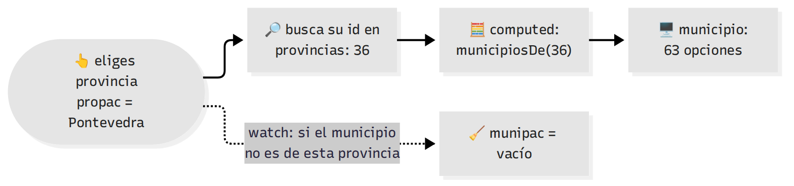

# Formularios y campos

[← Anterior: listas y filtros](01-listas-filtros-y-busqueda.md) · [Índice](README.md) · [Siguiente: rutas y componentes →](03-rutas-y-componentes.md)

Todo lo que pueden pedirte sobre **un formulario**: un campo nuevo, un desplegable, un número, un sí o no, desplegables en cascada, un valor calculado, validaciones y baja lógica. Sin salir de esta página.

## En esta página

1. [Cómo está montado un formulario](#1-cómo-está-montado-un-formulario)
2. [Lo que necesitas saber](#2-lo-que-necesitas-saber)
3. [Campo de texto nuevo](#3-campo-de-texto-nuevo)
4. [Desplegable con valores fijos](#4-desplegable-con-valores-fijos)
5. [Número y sí o no](#5-número-y-sí-o-no)
6. [Provincia y municipio en cascada](#6-provincia-y-municipio-en-cascada)
7. [Un valor calculado: la edad](#7-un-valor-calculado-la-edad)
8. [Dar de baja sin borrar](#8-dar-de-baja-sin-borrar)
9. [Validar mientras se escribe](#9-validar-mientras-se-escribe)
10. [Validar en el servidor](#10-validar-en-el-servidor)
11. [Si te piden esto, mira aquí](#11-si-te-piden-esto-mira-aquí)
12. [Fallos que quitan puntos](#12-fallos-que-quitan-puntos)
13. [Recetas cortas y lecciones](#13-recetas-cortas-y-lecciones)

## 1. Cómo está montado un formulario

Los tres formularios (pacientes, doctores, citas) siguen el mismo patrón. Si lo entiendes en uno, los entiendes todos.

| Pieza | Dónde | Qué hace |
|---|---|---|
| El molde | `PACIENTE_BALEIRO`, `DOUTOR_BALEIRO`, `CITA_BALEIRA` en la vista | Un objeto con **todos** los campos y su valor vacío |
| `useFormulario(molde)` | `src/composables/useFormulario.js` | Devuelve `datos` (lo que se enlaza con `v-model`), `idEditando`, `resetear()` y `cargar(fila)` |
| `FormField` y `FormGrid` | `src/components/ui/` | La etiqueta con su campo y la rejilla; `FormGrid` emite `enviar` al hacer submit |
| `columnas` | en la vista | Qué columnas salen en la tabla y en el PDF |
| El modelo | `backend/modelos/` | Qué campos acepta el servidor y con qué reglas |

El camino de un campo nuevo, de la pantalla a la base de datos y vuelta:

1. Está en el **molde**, para que exista en `datos` y se pueda editar.
2. Tiene su **input** con `v-model="datos.campo"`.
3. Está en el **modelo** de Mongoose, si no el servidor lo ignora al guardar.
4. Está en **`columnas`**, si debe verse en la tabla y en el PDF.

Si falta uno de los cuatro, el campo falla de una forma distinta cada vez (ver [fallos](#12-fallos-que-quitan-puntos)).

## 2. Lo que necesitas saber

**`reactive` y `datos`**: `useFormulario` crea `datos` con `reactive`, un objeto vigilado entero. Cada campo del objeto es reactivo, y se usa **sin** `.value`: `datos.nomepac`. → `03_lecciones/01_reactividad.md §3`

**`v-model` según el campo**: en un `<input type="text">`, atado al texto. En un `<select>`, al `:value` de la opción elegida. En un `<input type="checkbox">`, a `true` o `false`. En un `<input type="number">`, escribe un **texto** salvo que uses `v-model.number`. → `03_lecciones/vue/02_v_model.md`

**`cargar(fila)`**: para editar, copia a `datos` los campos de una fila, pero **solo los que están en el molde**. Si un campo nuevo no está en el molde, al editar sale vacío.

**`watch`**: ejecuta código cuando cambia un dato. Se usa en la cascada para vaciar el municipio. → `03_lecciones/01_reactividad.md §5`

**Schema de Mongoose**: la forma de un documento: qué campos tiene, de qué tipo y con qué reglas (`required`, `enum`, `match`, `default`...). Un campo que no está en el schema no se guarda, aunque lo envíes. → `03_lecciones/03_crud_api_rest.md §4`

## 3. Campo de texto nuevo

Ejemplo: `alerxiaspac`, opcional, en pacientes.

Modelo (`backend/modelos/Paciente.js`), dentro del schema:

```js
alerxiaspac: { type: String, trim: true, default: '' },
```

Vista (`XestionPacientes.vue`): el molde, el campo y la columna.

```js
const PACIENTE_BALEIRO = {
  // ...los que ya había
  alerxiaspac: "",
};
```

```vue
<FormField label="Alerxias:" class="col-span-full">
  <input v-model="datos.alerxiaspac" type="text">
</FormField>
```

```js
{ clave: "alerxiaspac", titulo: "Alerxias" },
```

`class="col-span-full"` hace que el campo ocupe toda la fila de la rejilla. Para que el campo sea obligatorio: `required: true` en el modelo y el atributo `required` en el `<input>`.

**Qué deberías ver**: reinicia el backend, crea un paciente con el campo, recarga y edítalo: el valor aparece en el formulario, en la tabla y en el PDF.

## 4. Desplegable con valores fijos

Ejemplo: grupo sanguíneo, con una lista cerrada.

Modelo, con `enum`: cualquier otro valor da error `400`.

```js
gruposanpac: { type: String, enum: ['', 'A+', 'A-', 'B+', 'B-', 'AB+', 'AB-', '0+', '0-'], default: '' },
```

Vista: la lista fuera del `<template>` y un `v-for`.

```js
const GRUPOS = ["A+", "A-", "B+", "B-", "AB+", "AB-", "0+", "0-"];
```

```vue
<FormField label="Grupo sanguíneo:">
  <select v-model="datos.gruposanpac">
    <option value="">Sen indicar</option>
    <option v-for="g in GRUPOS" :key="g" :value="g">{{ g }}</option>
  </select>
</FormField>
```

La opción vacía permite no elegir. Si el campo fuera obligatorio, esa opción llevaría `disabled`, como la de «Selecciona paciente» en el formulario de citas.

## 5. Número y sí o no

**Número** (peso en kg):

```js
pesopac: { type: Number, min: 1, max: 400 },
```

```vue
<FormField label="Peso (kg):">
  <input v-model.number="datos.pesopac" type="number" min="1" max="400">
</FormField>
```

`.number` convierte el texto a número. Un campo vacío da `""`, no un número: antes de enviar, si lo dejas vacío, pásalo a `undefined` o Mongoose rechazará la cadena vacía.

**Sí o no** (`fumador`):

```js
fumadorpac: { type: Boolean, default: false },
```

```vue
<FormField label="Fumador:">
  <input v-model="datos.fumadorpac" type="checkbox">
</FormField>
```

El molde lleva `false`, no `""`. En la tabla, un `true` se ve como `true` si no lo traduces:

```js
{ clave: "fumadorpac", titulo: "Fumador", formato: (p) => (p.fumadorpac ? "Si" : "Non") },
```

## 6. Provincia y municipio en cascada

El profesor lo tiene así en su formulario. Se eligen en dos desplegables: el segundo muestra solo los municipios de la provincia del primero, y se guarda el **nombre** (`propac: "Pontevedra"`).



**Por qué hace falta buscar el id**: los municipios se enlazan con su provincia por el código INE (los dos primeros dígitos del id del municipio son el id de la provincia), pero el paciente guarda el nombre. `municipioStore` ya tiene `provincias`, `municipios` y `municipiosDe(idProvincia)`.

En `XestionPacientes.vue`:

```js
import { ref, computed, watch } from "vue";
import { useMunicipioStore } from "../store/municipioStore.js";

const municipioStore = useMunicipioStore();
const { provincias } = storeToRefs(municipioStore);

// Se cargan junto a los pacientes
const { cargando, erro } = useCargaInicial(() =>
  Promise.all([pacienteStore.cargarPacientes(), municipioStore.cargarMunicipios()])
);

// De la provincia elegida (por nombre) sale su id, y de él sus municipios
const municipiosDaProvincia = computed(() => {
  const provincia = provincias.value.find((p) => p.nm === datos.propac);
  return municipioStore.municipiosDe(provincia?.id);
});

// Al cambiar de provincia, si el municipio elegido no es de la nueva, se vacía
watch(
  () => datos.propac,
  () => {
    if (!municipiosDaProvincia.value.some((m) => m.nm === datos.munipac)) datos.munipac = "";
  }
);
```

```vue
<FormField label="Provincia:">
  <select v-model="datos.propac" required>
    <option value="" disabled>Selecciona provincia</option>
    <option v-for="p in provincias" :key="p.id" :value="p.nm">{{ p.nm }}</option>
  </select>
</FormField>
<FormField label="Municipio:">
  <select v-model="datos.munipac" :disabled="!datos.propac">
    <option value="">Selecciona municipio</option>
    <option v-for="m in municipiosDaProvincia" :key="m.id" :value="m.nm">{{ m.nm }}</option>
  </select>
</FormField>
```

**Qué deberías ver**: el municipio empieza desactivado. Al elegir Pontevedra aparecen 63 municipios; si eliges Vigo y cambias a Lugo, el municipio se vacía y salen los 68 de Lugo. Al editar un paciente, se cargan los dos.

Otras cascadas se hacen igual: especialidad y doctor (el segundo `computed` filtra `doctores` por `espedoc`), o provincia y centro de salud.

## 7. Un valor calculado: la edad

La edad no se guarda: sale de la fecha de nacimiento. Se calcula al mostrarla, con `formato` en `columnas`. En `src/utils/fechas.js`:

```js
export function edad(nacimiento) {
  if (!nacimiento) return "—";
  const hoy = new Date();
  const nace = new Date(`${nacimiento}T00:00:00`);
  const aunNoCumplidos =
    hoy.getMonth() < nace.getMonth() ||
    (hoy.getMonth() === nace.getMonth() && hoy.getDate() < nace.getDate());
  return hoy.getFullYear() - nace.getFullYear() - (aunNoCumplidos ? 1 : 0);
}
```

```js
import { edad } from "../utils/fechas.js";

{ clave: "nacipac", titulo: "Idade", formato: (p) => edad(p.nacipac) },
```

Restar solo los años daría un año de más a quien aún no ha cumplido este año: por eso se comprueba si ya pasó su cumpleaños. `T00:00:00` evita que la fecha se interprete como UTC y cambie de día según la zona horaria.

Es la misma técnica para cualquier valor calculado: la duración entre dos horas, los días que faltan para una cita, el nombre completo. `formato` recibe la fila entera.

## 8. Dar de baja sin borrar

Un campo `activo` y un interruptor, en vez de eliminar. Muy habitual cuando hay citas asociadas.

Modelo: por defecto activo.

```js
activo: { type: Boolean, default: true },
```

Molde `activo: true`, y en el formulario un checkbox como el del apartado 5. En la tabla:

```js
{ clave: "activo", titulo: "Estado", formato: (d) => (d.activo === false ? "Baixa" : "Activo") },
```

Se compara con `=== false` porque los doctores ya guardados no tienen el campo: son `undefined`, y deben contar como activos.

Para ver solo los activos, un filtro de cliente (ver [listas, apartado 4](01-listas-filtros-y-busqueda.md#4-filtrar-por-estado-y-por-doctor)):

```js
const soloActivos = ref(true);
const doctoresVisibles = computed(() =>
  soloActivos.value ? doctores.value.filter((d) => d.activo !== false) : doctores.value
);
```

## 9. Validar mientras se escribe

Hay tres niveles, de menos a más control:

1. **Atributos HTML** (`required`, `pattern`, `min`, `max`, `minlength`): el navegador avisa al enviar.
2. **Un error bajo el campo**, que aparece al salir de él (`@blur`) y no mientras escribes la primera letra.
3. **Botón desactivado** hasta que todo esté bien.

El nivel 2, para un teléfono de 9 dígitos. `FormField` tiene la prop `error`, que pinta el mensaje bajo el campo:

```js
const tocadoMovil = ref(false);
const erroMovil = computed(() =>
  tocadoMovil.value && !/^[0-9]{9}$/.test(datos.movilpac) ? "O teléfono debe ter 9 díxitos" : ""
);
```

```vue
<FormField label="Móbil:" :error="erroMovil">
  <input v-model="datos.movilpac" type="tel" required
    :aria-invalid="Boolean(erroMovil)" @blur="tocadoMovil = true">
</FormField>
```

El nivel 3, en el botón de guardar:

```vue
<AppButton variante="primario" type="submit" :disabled="Boolean(erroMovil) || !datos.nomepac.trim()">
  Gardar
</AppButton>
```

Fecha de nacimiento que no sea futura, y edad mínima, con el mismo esquema:

```js
const erroNacemento = computed(() => {
  if (!datos.nacipac) return "";
  const hoxe = new Date().toLocaleDateString("sv-SE");
  return datos.nacipac > hoxe ? "A data non pode ser futura" : "";
});
```

`toLocaleDateString("sv-SE")` devuelve `AAAA-MM-DD` en hora local. El DNI ya tiene su propia comprobación (`validarDni`) en `XestionPacientes.vue`: es el modelo a copiar para validar con una función.

## 10. Validar en el servidor

La web evita errores, pero el servidor no se fía: la API también se puede llamar sin la web. Las reglas compartidas están en `backend/modelos/validaciones.js` (`DNI`, `TELEFONO`, `CORREO`, `HORA`, `FECHA`) y se usan en el campo:

```js
movilpac: { type: String, required: true, trim: true, match: TELEFONO },
```

Una regla nueva, un código postal:

```js
// validaciones.js
export const CODIGO_POSTAL = [/^[0-9]{5}$/, 'O código postal debe ter 5 díxitos']

// en el modelo
cpac: { type: String, match: CODIGO_POSTAL },
```

Cuando una regla falla, el servidor responde `400` con el mensaje, y la vista lo enseña con `alertaError(mensajeError(e))`. Que el mensaje esté en gallego y diga qué corregir.

Más reglas de Mongoose: `enum`, `min` y `max` (números), `minlength` y `maxlength` (textos), `unique` (que no se repita; da `409`) y `validate` con una función propia. Ejemplos con horario y fines de semana: [receta de backend](../funcionalidades/backend/horario-y-fines-de-semana.md).

## 11. Si te piden esto, mira aquí

| El enunciado dice | Apartado |
|---|---|
| «añade un campo X a pacientes (o doctores, o citas)» | [3](#3-campo-de-texto-nuevo) |
| «desplegable con...», «lista fija de opciones» | [4](#4-desplegable-con-valores-fijos) |
| «campo numérico», «sí o no», «casilla» | [5](#5-número-y-sí-o-no) |
| «provincia y municipio», «al elegir una, la otra se rellena» | [6](#6-provincia-y-municipio-en-cascada) |
| «muestra la edad», «campo calculado» | [7](#7-un-valor-calculado-la-edad) |
| «dar de baja», «activo o inactivo» | [8](#8-dar-de-baja-sin-borrar) |
| «validar», «mensaje de error», «botón desactivado» | [9](#9-validar-mientras-se-escribe) |
| «el servidor debe rechazar...» | [10](#10-validar-en-el-servidor) |

## 12. Fallos que quitan puntos

| Síntoma | Causa |
|---|---|
| El campo sale vacío al editar | Falta en el molde: `cargar` solo copia lo que está en él |
| Se guarda pero al recargar no está | Falta en el schema de Mongoose: el servidor lo ignora |
| Se ve en el formulario pero no en la tabla | Falta en `columnas` |
| Error `400` al guardar un número | `v-model` sin `.number`: llega un texto |
| Un checkbox guarda `""` | El molde tiene `""` en vez de `false` |
| El desplegable no muestra la opción guardada | El `:value` de las opciones no coincide con lo guardado (id contra nombre) |
| El municipio no se vacía al cambiar de provincia | Falta el `watch` sobre `datos.propac` |
| `datos.campo.value` da error | `datos` es `reactive`: no lleva `.value`; los `ref` sí |
| Los doctores antiguos salen «Baixa» | Se compara con `!d.activo` en vez de `=== false` |
| Un `enum` rechaza la opción vacía | La cadena vacía hay que incluirla en la lista del `enum` |

## 13. Recetas cortas y lecciones

- Recetas: [campo nuevo](../funcionalidades/datos/campo-nuevo.md) · [validaciones](../funcionalidades/validacion/validaciones.md) · [horario y fines de semana](../funcionalidades/backend/horario-y-fines-de-semana.md) · [entidad nueva](../funcionalidades/datos/entidad-nueva.md)
- Guías: [campo nuevo](../guias/campo-nuevo.md) · [validación nueva](../guias/validacion-nueva.md)
- Lecciones de `diw-study`: `03_lecciones/01_reactividad.md` · `03_lecciones/vue/02_v_model.md` · `03_lecciones/03_crud_api_rest.md`

[← Anterior: listas y filtros](01-listas-filtros-y-busqueda.md) · [Índice](README.md) · [Siguiente: rutas y componentes →](03-rutas-y-componentes.md)
