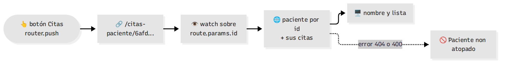

# Rutas, navegación y componentes

[← Anterior: formularios y campos](02-formularios-y-campos.md) · [Índice](README.md)

Todo lo que pueden pedirte sobre **pantallas y piezas reutilizables**: una página nueva, una ruta con parámetro, filtros por la URL, proteger rutas, un componente hijo con props y emit, un modal, un `v-model` propio y un reloj. Sin salir de esta página.

## En esta página

1. [Cómo está montado el router](#1-cómo-está-montado-el-router)
2. [Lo que necesitas saber](#2-lo-que-necesitas-saber)
3. [Una página nueva](#3-una-página-nueva)
4. [Ruta con parámetro](#4-ruta-con-parámetro)
5. [Filtrar por la URL](#5-filtrar-por-la-url)
6. [Navegar desde el código](#6-navegar-desde-el-código)
7. [Título de la pestaña](#7-título-de-la-pestaña)
8. [Proteger rutas con un login sencillo](#8-proteger-rutas-con-un-login-sencillo)
9. [Componente hijo con props y emit](#9-componente-hijo-con-props-y-emit)
10. [Un v-model propio](#10-un-v-model-propio)
11. [Un modal con slots](#11-un-modal-con-slots)
12. [Ciclo de vida: un reloj](#12-ciclo-de-vida-un-reloj)
13. [Si te piden esto, mira aquí](#13-si-te-piden-esto-mira-aquí)
14. [Fallos que quitan puntos](#14-fallos-que-quitan-puntos)
15. [Recetas cortas y lecciones](#15-recetas-cortas-y-lecciones)

## 1. Cómo está montado el router

| Fichero | Qué hace |
|---|---|
| `src/router/index.js` | **La única lista de pantallas.** Cada entrada: `path`, `name`, `component` y `meta` |
| `src/router/index.js` | Crea el router con esa lista (`createRouter` y `createWebHistory`) |
| `src/main.js` | Enchufa Pinia y el router a la app |
| `src/App.vue` | El esqueleto; `<router-view />` es el hueco donde se pinta la pantalla de la URL |
| `src/components/NavBar.vue` | El menú: lee `routes.js` y pinta las rutas con `meta.menu === "principal"` |

De `routes.js` salen tres cosas a la vez: las rutas, el menú y los enlaces legales del pie. Por eso una pantalla nueva necesita **una sola entrada** más su `.vue`. La ruta `/:pathMatch(.*)*` va **al final**: recoge todo lo que no coincide y muestra el 404.

`meta` es un objeto libre para guardar datos de la ruta: aquí `titulo`, `icono` y `menu`. Es también el sitio para marcar rutas protegidas (apartado 8).

## 2. Lo que necesitas saber

**SPA**: la web carga una sola vez y el router cambia el componente que se ve, sin recargar la página. → `03_lecciones/02_router_comunicacion.md §1`

**`useRoute` y `useRouter`**: dos cosas distintas. `useRoute()` es la ruta **actual** (de dónde leer: `route.params`, `route.query`, `route.path`). `useRouter()` es el router (a quien **ordenar** algo: `router.push(...)`, `router.back()`). Confundirlos es un fallo clásico.

**Parámetros y query**: `/citas-paciente/6afd...` tiene un **parámetro** (`:id`), que se lee en `route.params.id`. `/citas?doctor=6afd` tiene un **query** (lo de detrás del `?`), que se lee en `route.query.doctor`.

**`watch` sobre la ruta**: al pasar de `/citas-paciente/1` a `/citas-paciente/2` Vue **reutiliza** el mismo componente: no se vuelve a ejecutar `onMounted`. Por eso se vigila `route.params.id` con `watch`, con `immediate: true` para que también se ejecute al entrar. → `03_lecciones/02_router_comunicacion.md §6`

**Props y emit**: los datos bajan del padre al hijo por **props** (el hijo solo los lee); los avisos suben del hijo al padre por **emit**. El hijo no modifica lo que le llega: pide al padre que lo haga. → `03_lecciones/02_router_comunicacion.md §8`

**Slot**: un hueco en un componente que rellena quien lo usa. → `03_lecciones/02_router_comunicacion.md §8`

## 3. Una página nueva

Dos pasos:

1. Crea `src/components/MiPantalla.vue`.
2. Añade una entrada en `src/router/index.js`, **antes** de la ruta de 404:

```js
{
  path: "/xestion-aseguradoras",
  name: "xestion-aseguradoras",
  component: () => import("../views/XestionAseguradoras.vue"),
  meta: { titulo: "Aseguradoras", icono: ShieldCheck, menu: "principal" },
},
```

`() => import(...)` carga la pantalla solo cuando se visita (carga perezosa). El icono es un componente de `lucide-vue-next`, que se importa arriba del fichero. Con `menu: "principal"` sale en la barra; sin `menu`, la ruta existe pero no aparece (como el 404). Un enlace a ella desde otra pantalla: `<RouterLink to="/xestion-aseguradoras">`.

## 4. Ruta con parámetro

Ejemplo: un botón «Citas» en cada paciente que lleva a `/citas-paciente/:id`, con su nombre y sus citas.



**La ruta**, antes del 404 y sin `menu` (no debe salir en la barra):

```js
{
  path: "/citas-paciente/:id",
  name: "citas-paciente",
  component: () => import("../views/CitasPaciente.vue"),
  meta: { titulo: "Citas do paciente" },
},
```

**La API**: no hay una función para pedir un paciente por id (el backend sí tiene `GET /api/pacientes/:id`). En `src/api/pacientes.js`:

```js
export async function obtenerPacientePorId(id) {
  const respuesta = await axios.get(`${URL}/${id}`);
  return respuesta.data;
}
```

**La pantalla** `src/components/CitasPaciente.vue`:

```vue
<script setup>
import { ref, watch } from "vue";
import { useRoute } from "vue-router";
import { obtenerPacientePorId } from "../api/pacientes.js";
import { obtenerCitas } from "../api/citas.js";
import PageHeader from "../components/ui/PageHeader.vue";
import AppButton from "../components/ui/AppButton.vue";

const route = useRoute();
const paciente = ref(null);
const citas = ref([]);
const noAtopado = ref(false);

watch(
  () => route.params.id,
  async (id) => {
    noAtopado.value = false;
    try {
      paciente.value = await obtenerPacientePorId(id);
      citas.value = await obtenerCitas({ paciente: paciente.value.dnipac });
    } catch {
      paciente.value = null;
      noAtopado.value = true;
    }
  },
  { immediate: true }
);
</script>

<template>
  <PageHeader :titulo="paciente ? `Citas de ${paciente.nomepac} ${paciente.apelpac}` : 'Citas do paciente'" />

  <p v-if="noAtopado">Paciente non atopado</p>
  <ul v-else>
    <li v-for="c in citas" :key="c.id">{{ c.fecha }} {{ c.hora }}: {{ c.motivo }}</li>
  </ul>

  <RouterLink to="/xestionPacientes">
    <AppButton>Volver a pacientes</AppButton>
  </RouterLink>
</template>
```

Por qué `watch(() => route.params.id, ...)` y no `watch(route.params.id, ...)`: el primero es una función que se vuelve a evaluar; el segundo vigilaría un valor fijo que no cambia. Una `catch` sin variable (`catch {`) basta cuando no usas el error. Con un id mal formado el backend responde `400` y con uno que no existe `404`: los dos caen en `catch` y salen en «non atopado».

**El botón en la tabla de pacientes**, en el slot de `RowActions`:

```js
import { useRouter } from "vue-router";
import { CalendarDays } from "lucide-vue-next";
const router = useRouter();
```

```vue
<AppButton variante="fantasma" icono title="Citas" aria-label="Citas"
  @click="router.push(`/citas-paciente/${fila.id}`)">
  <CalendarDays :size="16" />
</AppButton>
```

**Qué deberías ver**: al pulsar, la URL cambia y salen el nombre y las citas. Cambia el id a mano por uno falso: «Paciente non atopado». Con «Volver» regresas a pacientes.

## 5. Filtrar por la URL

Un filtro que viaja en la dirección se puede compartir y sobrevive a F5. Ejemplo: `/citas?doctor=<id>` abre citas ya filtradas por ese doctor.

**Quien enlaza** (en doctores, un botón «Ver citas»):

```js
router.push({ path: "/citas", query: { doctor: fila.id } });
```

**Quien lee** (`XestionCitas.vue`): al montar, si la URL trae `doctor`, se usa como filtro.

```js
import { useRoute } from "vue-router";
const route = useRoute();

// justo después de crear el store, antes de la carga inicial
if (route.query.doctor) citaStore.idDoctor = String(route.query.doctor);
```

El formulario ya arranca con `idDoctor` y la lista se pide filtrada. Para que al elegir un filtro la URL se actualice: `router.replace({ query: { doctor: valor } })`. `replace` cambia la dirección sin añadir una entrada nueva al historial; `push` sí la añade.

## 6. Navegar desde el código

```js
const router = useRouter();

router.push("/citas");                         // por ruta
router.push({ name: "citas-paciente", params: { id } }); // por nombre, con parámetro
router.push({ path: "/citas", query: { doctor: id } });
router.back();                                         // atrás en el historial
router.replace("/");                                   // sin dejar rastro en el historial
```

Navegar por **nombre** es más seguro que por texto: si cambia el `path`, no se rompe. Los enlaces del template se hacen con `<RouterLink to="...">`, que no recarga la página; un `<a href>` sí recargaría.

## 7. Título de la pestaña

Cada pantalla tiene su `meta.titulo`; falta ponerlo en la pestaña del navegador. En `src/router/index.js`, tras crear el router:

```js
router.afterEach((to) => {
  document.title = to.meta.titulo ? `${to.meta.titulo} · Sanidad Teis` : "Sanidad Teis";
});
```

`afterEach` se ejecuta tras cada navegación y recibe la ruta de destino (`to`).

## 8. Proteger rutas con un login sencillo

Un guard (guardia) es una función que decide si una navegación se permite. Hace falta un store que recuerde si hay sesión, una marca en las rutas protegidas y el guard.

**Store** (`src/store/authStore.js`), con el mismo patrón que `doctorStore`:

```js
import { ref } from "vue";
import { defineStore } from "pinia";

export const useAuthStore = defineStore("auth", () => {
  const usuario = ref("");
  const logueado = ref(false);

  function entrar(nome, clave) {
    // sencillo: un usuario fijo. Un login real validaría contra el backend.
    if (nome === "admin" && clave === "1234") {
      usuario.value = nome;
      logueado.value = true;
      return true;
    }
    return false;
  }

  function sair() {
    usuario.value = "";
    logueado.value = false;
  }

  return { usuario, logueado, entrar, sair };
});
```

**Marca** en las rutas que lo necesiten, dentro de `meta`:

```js
meta: { titulo: "Doctores", icono: Stethoscope, menu: "principal", requiereLogin: true },
```

**Guard** en `router/index.js`:

```js
import { useAuthStore } from "../store/authStore.js";

router.beforeEach((to) => {
  const auth = useAuthStore();
  if (to.meta.requiereLogin && !auth.logueado) {
    return { name: "login", query: { destino: to.fullPath } };
  }
});
```

Si la función devuelve una ruta, el router **redirige** allí; si no devuelve nada, deja pasar. La pantalla `login` es una ruta más (sin `menu`) con dos campos y un botón que llama a `auth.entrar(...)` y, si va bien, hace `router.push(route.query.destino || "/")`.

Un detalle importante: el guard usa el store de Pinia, así que Pinia tiene que estar instalada antes de la primera navegación. En `main.js` ya lo está (`.use(createPinia()).use(router)`, en ese orden).

Un login así **no es seguro**: cualquiera puede leer el usuario y la clave en el código del navegador. Sirve para enseñar el mecanismo; la seguridad real exige validar en el backend (por ejemplo con tokens JWT).

## 9. Componente hijo con props y emit

Ejemplo: en `Servizos`, al pulsar una especialidad salen sus doctores en tarjetas, y cada tarjeta avisa al padre cuando se pulsa «Pedir cita».

**El hijo** `src/components/TarxetaDoctor.vue`:

```vue
<script setup>
import AppButton from "./ui/AppButton.vue";

defineProps({
  doctor: { type: Object, required: true },
});
const emit = defineEmits(["pedir-cita"]);
</script>

<template>
  <article class="rounded-xl bg-subtle p-4">
    <h3 class="font-medium">{{ doctor.nomedoc }} {{ doctor.apeldoc }}</h3>
    <p class="text-sm text-fg-soft">{{ doctor.movildoc }} · {{ doctor.maildoc }}</p>
    <AppButton variante="primario" @click="emit('pedir-cita', doctor)">Pedir cita</AppButton>
  </article>
</template>
```

`defineProps` declara qué datos puede recibir. `defineEmits` declara qué avisos puede enviar. `emit('pedir-cita', doctor)` envía el aviso con un dato.

**El padre**:

```js
import { ref } from "vue";
import { useRouter } from "vue-router";
import { obtenerDoctores } from "../api/doctores.js";
import { useCitaStore } from "../store/citaStore.js";
import TarxetaDoctor from "../components/TarxetaDoctor.vue";

const router = useRouter();
const citaStore = useCitaStore();
const doctores = ref([]);

async function verDoctores(nomeEspecialidade) {
  doctores.value = await obtenerDoctores(nomeEspecialidade);
}

function pedirCita(doctor) {
  citaStore.idDoctor = doctor.id;
  router.push("/citas");
}
```

```vue
<button v-for="e in especialidades" :key="e.id" @click="verDoctores(e.nomeesp)">{{ e.nomeesp }}</button>

<TarxetaDoctor v-for="d in doctores" :key="d.id" :doctor="d" @pedir-cita="pedirCita" />
```

Dos nombres que se confunden: en el hijo se escribe `emit('pedir-cita')`, y en el padre se escucha con `@pedir-cita`. Los dos tienen que coincidir. `:doctor="d"` (con dos puntos) pasa el **objeto**; sin los dos puntos pasaría el texto «d».

`especialidades` sale de `especialidadStore` (`cargarEspecialidades()`), como en `XestionDoctores.vue`. Al llegar a Citas, el formulario ya arranca con ese doctor elegido porque `citaStore.idDoctor` está puesto.

## 10. Un v-model propio

Un componente que se comporta como un campo: el padre lo usa con `v-model` y recibe el valor. Con `defineModel` (Vue 3.4 o posterior; el proyecto usa 3.5) es muy corto. Ejemplo: un buscador reutilizable, `src/components/BuscadorTexto.vue`:

```vue
<script setup>
const texto = defineModel({ type: String, default: "" });
defineProps({ placeholder: { type: String, default: "Buscar..." } });
</script>

<template>
  <input v-model="texto" type="search" :placeholder="placeholder">
</template>
```

Y se usa así:

```vue
<BuscadorTexto v-model="busca" placeholder="Buscar paciente" />
```

`defineModel` devuelve un `ref` ligado al `v-model` del padre: escribir en `texto` cambia `busca` en el padre. Es el atajo de lo que antes eran una prop `modelValue` y un emit `update:modelValue`.

## 11. Un modal con slots

Un modal reutilizable: lo que va dentro lo decide quien lo usa. `src/components/ModalBase.vue`:

```vue
<script setup>
const abierto = defineModel({ type: Boolean, default: false });
defineProps({ titulo: { type: String, default: "" } });
</script>

<template>
  <div v-if="abierto" class="fixed inset-0 z-20 flex items-center justify-center bg-black/40"
    @click.self="abierto = false">
    <div class="w-full max-w-md rounded-2xl bg-raised p-6">
      <h2 class="mb-4 text-lg font-semibold">{{ titulo }}</h2>
      <slot />
      <div class="mt-6 flex justify-end gap-2">
        <slot name="acciones">
          <button type="button" @click="abierto = false">Pechar</button>
        </slot>
      </div>
    </div>
  </div>
</template>
```

Uso:

```vue
<script setup>
import { ref } from "vue";
import ModalBase from "../components/ModalBase.vue";
const verCita = ref(false);
</script>

<template>
  <AppButton @click="verCita = true">Detalle</AppButton>

  <ModalBase v-model="verCita" titulo="Detalle da cita">
    <p>Motivo: {{ cita.motivo }}</p>
    <template #acciones>
      <AppButton @click="verCita = false">Pechar</AppButton>
    </template>
  </ModalBase>
</template>
```

- `<slot />` sin nombre recibe el contenido por defecto; `<slot name="acciones">` recibe lo que va dentro de `<template #acciones>`, y si no se rellena, muestra el contenido de reserva (el botón «Pechar»).
- `@click.self` cierra solo si se pulsa el fondo, no el cuadro de dentro.
- `v-if="abierto"` quita el modal del DOM cuando está cerrado.

## 12. Ciclo de vida: un reloj

Un componente tiene un ciclo: aparece (`onMounted`) y desaparece (`onUnmounted`). Lo que se pone en marcha al aparecer hay que pararlo al desaparecer, o se queda funcionando para siempre.

```vue
<script setup>
import { ref, onMounted, onUnmounted } from "vue";

const hora = ref(new Date().toLocaleTimeString("es-ES"));
let temporizador;

onMounted(() => {
  temporizador = setInterval(() => {
    hora.value = new Date().toLocaleTimeString("es-ES");
  }, 1000);
});

onUnmounted(() => clearInterval(temporizador));
</script>

<template>
  <span class="text-sm text-fg-soft">{{ hora }}</span>
</template>
```

`setInterval` repite una función cada tanto; devuelve un número que `clearInterval` usa para pararlo. Sin `onUnmounted`, al cambiar de pantalla y volver, habría dos relojes funcionando. → `03_lecciones/01_reactividad.md §6`

## 13. Si te piden esto, mira aquí

| El enunciado dice | Apartado |
|---|---|
| «página nueva», «enlace en el menú» | [3](#3-una-página-nueva) |
| «`/citas-paciente/:id`», «ruta con parámetro», «`watch` con `immediate`» | [4](#4-ruta-con-parámetro) |
| «non atopado», «si no existe» | [4](#4-ruta-con-parámetro) |
| «filtrar por la URL», «`?doctor=`» | [5](#5-filtrar-por-la-url) |
| «botón que lleva a», «volver atrás» | [6](#6-navegar-desde-el-código) |
| «título de la pestaña» | [7](#7-título-de-la-pestaña) |
| «login», «proteger rutas», «solo si hay sesión» | [8](#8-proteger-rutas-con-un-login-sencillo) |
| «componente hijo», «props», «emit», «tarjetas» | [9](#9-componente-hijo-con-props-y-emit) |
| «componente reutilizable con `v-model`» | [10](#10-un-v-model-propio) |
| «ventana modal», «slot» | [11](#11-un-modal-con-slots) |
| «reloj», «`onMounted`», «`onUnmounted`» | [12](#12-ciclo-de-vida-un-reloj) |

## 14. Fallos que quitan puntos

- La ruta nueva **después** de `/:pathMatch(.*)*`: nunca se alcanza, siempre sale el 404.
- `useRoute` por `useRouter` (o al revés): `route.push` no existe y `router.params` tampoco.
- `onMounted` en vez de `watch` para leer el parámetro: no se recarga al cambiar de id.
- `watch(route.params.id, ...)` sin función flecha: vigila un valor fijo.
- Olvidar `.value` al leer un `ref` en el script (`paciente.value.dnipac`).
- Un `<a href>` en vez de `<RouterLink>`: recarga la página y se pierde el estado de los stores.
- El nombre del evento no coincide: `emit('pedir-cita')` en el hijo y `@pedirCita` en el padre.
- `:doctor="d"` sin los dos puntos: se pasa el texto «d», no el objeto.
- Modificar una prop dentro del hijo: Vue avisa; hay que emitir un evento y que el padre cambie el dato.
- No parar un `setInterval` en `onUnmounted`.
- El guard usa un store de Pinia, pero Pinia se instala después del router en `main.js`.
- Una ruta con `menu: "principal"` sin `icono`: el menú falla al pintar el icono.

## 15. Recetas cortas y lecciones

- Recetas: [ruta con parámetro](../funcionalidades/pantallas/ruta-con-parametro.md) · [props y emit](../funcionalidades/pantallas/componente-props-emit.md) · [contador en el menú](../funcionalidades/pinia/contador-en-el-menu.md) · [selección con Pinia](../funcionalidades/pinia/pinia-seleccion.md)
- Guía: [pantalla nueva](../guias/pantalla-nueva.md)
- Lecciones de `diw-study`: `03_lecciones/02_router_comunicacion.md` · `03_lecciones/01_reactividad.md` · `03_lecciones/07_pinia.md`

[← Anterior: formularios y campos](02-formularios-y-campos.md) · [Índice](README.md)
