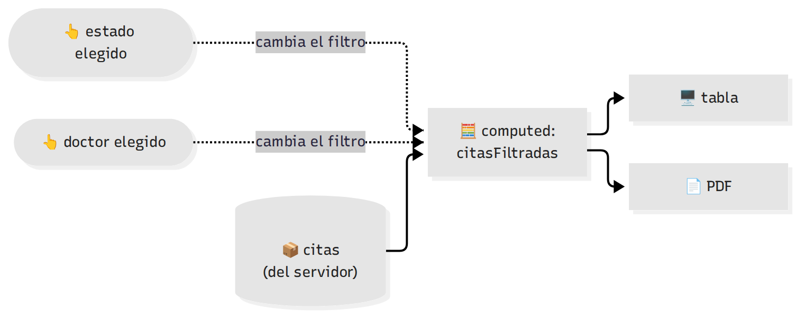

# Filtro en el cliente y PDF filtrado

Dos desplegables en la página de citas (estado y doctor). La tabla cambia al instante y el PDF solo trae las citas que se ven.

*Versión extendida, con variantes y más casos: [apuntes a fondo, apartado 4](../../detalle/01-listas-filtros-y-busqueda.md).*

**Antes de empezar:** arranca el proyecto (`npm start`) y abre la página **Citas** (`/citas`).

## La idea

La tabla no pide nada al servidor al filtrar. Las citas ya están cargadas y un `computed` se queda con las que cumplen los filtros. Cuando cambias un filtro, la lista se recalcula sola, y la tabla y el PDF, que leen esa lista, se actualizan.



## Qué vas a tocar

| Fichero | Para qué |
|---|---|
| `src/components/Citas.vue` | Todo: los filtros, la lista filtrada, la tabla y el PDF |

## Paso 1 · Importar `ref`

En `src/components/Citas.vue`, busca la línea `import { computed, watch } from "vue";` y **sustitúyela** por:

```js
import { ref, computed, watch } from "vue";
```

Qué hace: `ref` crea un dato que Vue vigila. Aquí guardará lo que el usuario elige en cada desplegable.

## Paso 2 · La lista filtrada

En `src/components/Citas.vue`, busca la línea `// Texto de la tabla cuando no hay filas: distingue "no hay citas" de "no hay con este filtro".` y pega este bloque **justo encima**:

```js
// Lo que ha elegido el usuario en cada desplegable ("" = todos). ref = una caja vigilada por Vue:
// si lo que hay dentro cambia, todo lo que la use se vuelve a calcular y a pintar.
const filtroEstado = ref("");
const filtroDoctor = ref("");

// Las citas que cumplen los filtros. computed = un valor calculado que se rehace SOLO cuando cambia
// algo de lo que lee (citas, filtroEstado, filtroDoctor). `citas` del store no se toca.
const citasFiltradas = computed(() =>
  // filter se queda con las citas para las que la función devuelve true
  citas.value.filter(
    (c) =>
      // Pasa si no hay estado elegido (!"" es true) o si el de la cita coincide...
      (!filtroEstado.value || c.estado === filtroEstado.value) &&
      // ...Y pasa si no hay doctor elegido o si el de la cita coincide
      (!filtroDoctor.value || c.doctorId === filtroDoctor.value)
  )
);
```

Qué hace: `(!filtroEstado.value || c.estado === filtroEstado.value)` significa «si no hay filtro, pasa; si lo hay, la cita tiene que coincidir». Las dos condiciones unidas con `&&` tienen que cumplirse a la vez.

## Paso 3 · Los dos desplegables

En `src/components/Citas.vue`, busca el comentario `<!-- Exporta a PDF todas las citas que hay ahora en la tabla -->`. Justo debajo hay un `<template #acciones>`. **Dentro de él, antes del `<AppButton`**, pega:

```vue
<!-- v-model ata cada desplegable a su ref: al elegir, el ref cambia y la tabla se recalcula -->
<select v-model="filtroEstado">
  <option value="">Todos os estados</option>
  <!-- Una opción por estado (v-for). :key = identificador único; :value = lo que se guarda en el ref -->
  <option v-for="e in estados" :key="e.valor" :value="e.valor">{{ e.texto }}</option>
</select>
<select v-model="filtroDoctor">
  <option value="">Todos os doctores</option>
  <option v-for="d in doctores" :key="d.id" :value="d.id">{{ d.nomedoc }} {{ d.apeldoc }}</option>
</select>
```

Qué hace: `v-model` ata cada desplegable a su `ref`. La opción con `value=""` es «Todos». `estados` y `doctores` ya existen en el fichero.

## Paso 4 · La tabla lee la lista filtrada

En `src/components/Citas.vue`, busca la línea `:filas="citas"` y **sustitúyela** por:

```vue
:filas="citasFiltradas"
```

## Paso 5 · El PDF lee la lista filtrada

En `src/components/Citas.vue`, busca estas dos líneas dentro de `async function descargarPdf()` y **sustitúyelas** por el bloque de debajo:

```js
const { cabeceras, filas } = datosParaPdf(columnas, citas.value);
await generarPDF("Listaxe de citas", cabeceras, filas, "citas.pdf");
```

```js
// El PDF lee la MISMA lista que la tabla: si hay filtro, el PDF solo trae lo filtrado
const { cabeceras, filas } = datosParaPdf(columnas, citasFiltradas.value);
// Si hay un doctor elegido, su nombre sale en el título del PDF (plantilla con `${...}`)
const titulo = filtroDoctor.value
  ? `Citas de ${doctorStore.nombrePorId(filtroDoctor.value)}`
  : "Listaxe de citas";
await generarPDF(titulo, cabeceras, filas, "citas.pdf");
```

## Paso 6 · El texto de «sin resultados»

Si los filtros no dejan ninguna fila, la tabla diría «Non hai citas cargadas.», que no es cierto. En `src/components/Citas.vue`, busca estas líneas y **sustitúyelas** por el bloque de debajo:

```js
const textoVacio = computed(() =>
  idPaciente.value || idDoctor.value
```

```js
const textoVacio = computed(() =>
  // Si hay CUALQUIER filtro puesto (también los dos nuevos), el texto dice "con este filtro"
  idPaciente.value || idDoctor.value || filtroEstado.value || filtroDoctor.value
```

Qué hace: el mensaje «Non hai citas con este filtro.» sale también cuando el vacío viene de los dos desplegables nuevos. Si pegaste el Paso 2 **encima** de `textoVacio`, `filtroEstado` y `filtroDoctor` ya existen en ese punto.

## Qué deberías ver

1. Dos desplegables nuevos junto al botón PDF.
2. Al elegir un doctor, la tabla se queda solo con sus citas, sin recargar la página.
3. Con «Todos os doctores» vuelven todas.
4. El PDF trae solo las filas que ves, y si hay un doctor elegido, su nombre sale en el título.

## Si algo falla

| Síntoma | Causa y arreglo |
|---|---|
| El desplegable cambia pero la tabla no | Falta el Paso 4: la tabla sigue leyendo `citas` |
| Error `ref is not defined` | Falta el Paso 1 |
| El PDF sigue trayendo todas | Falta el Paso 5 |
| No sale ningún doctor en el desplegable | Los doctores aún no han cargado: espera un segundo y recarga |
| «Todos» no funciona | La opción debe tener `value=""` exactamente |

## Conceptos que usa

| Concepto | En una línea | Se explica en (raíz de `diw-study`) |
|---|---|---|
| `computed` | Un dato que se calcula solo a partir de otros y se rehace cuando cambian | `03_lecciones/vue/07_computed.md` |
| `ref` | Una caja vigilada: si su valor cambia, la pantalla se repinta | `03_lecciones/01_reactividad.md §2` |
| `v-model` | Ata un campo del formulario a un dato en los dos sentidos | `03_lecciones/vue/02_v_model.md` |
| Exportar lo filtrado | Pasar al PDF la misma lista que ve la tabla | `03_lecciones/06_pdf.md §7` |

## Guías relacionadas

- [Guía: filtro nuevo](../../guias/filtro-nuevo.md)
