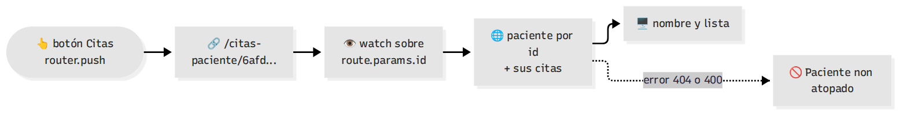

# Ruta con parámetro

Un botón «Citas» en cada fila de pacientes que lleva a `/citas-paciente/<id>`: una página nueva con el nombre del paciente y la lista de sus citas. Si el id no existe, avisa. Tiene un botón para volver.

*Versión extendida, con variantes y más casos: [apuntes a fondo, apartado 4](../../detalle/03-rutas-y-componentes.md).*

**Antes de empezar:** arranca el proyecto (`npm start`) y abre la página **Pacientes** (`/xestionPacientes`). Necesitas al menos un paciente.

## La idea



La parte `:id` de la ruta es un **parámetro**: puede valer cualquier cosa, y la página lo lee con `route.params.id`. Cuando el id de la URL cambia, Vue **reutiliza** el mismo componente y no vuelve a ejecutar `onMounted`; por eso se usa `watch`.

## Qué vas a tocar

| Fichero | Para qué |
|---|---|
| `src/router/index.js` | La ruta nueva |
| `src/api/pacientes.js` | Una función para pedir un paciente por su id |
| `src/components/CitasPaciente.vue` | **Nuevo.** La página |
| `src/components/XestionPacientes.vue` | El botón «Citas» de cada fila |

## Paso 1 · La ruta

En `src/router/index.js`, busca la línea `path: "/:pathMatch(.*)*",`. Es la entrada del error 404, que tiene que ir **la última**. Pega este bloque **justo encima del `{` que abre esa entrada**:

```js
  {
    // `:id` es un parámetro: la URL /citas-paciente/abc123 también encaja, y `abc123` llega a la página
    path: "/citas-paciente/:id",
    name: "citas-paciente",
    // import(...) carga la página solo cuando se entra en ella (más rápido el arranque)
    component: () => import("../views/CitasPaciente.vue"),
    // Sin `menu` en meta: la ruta existe pero NO sale en el menú ni en el pie
    meta: { titulo: "Citas do paciente" },
  },
```

Qué hace: sin `menu` en `meta`, la ruta existe pero no sale en la barra de navegación.

## Paso 2 · La función de la API

Abre `src/api/pacientes.js` y pega esto **al final del fichero**:

```js
// GET /api/pacientes/:id -> un paciente por su id
export async function obtenerPacientePorId(id) {
  // Plantilla con `${...}`: la URL final es .../api/pacientes/abc123
  const respuesta = await axios.get(`${URL}/${id}`);
  return respuesta.data; // axios envuelve la respuesta; los datos están en .data
}
```

## Paso 3 · La página

Crea `src/components/CitasPaciente.vue`:

```vue
<script setup>
import { ref, watch } from "vue";
import { useRoute } from "vue-router";
import { obtenerPacientePorId } from "../api/pacientes.js";
import { obtenerCitas } from "../api/citas.js";
import PageHeader from "../components/ui/PageHeader.vue";
import AppButton from "../components/ui/AppButton.vue";

// useRoute() es la ruta actual: de ahí se lee el parámetro (route.params.id)
const route = useRoute();
// ref = cajas vigiladas por Vue: al rellenarlas, la pantalla se repinta sola
const paciente = ref(null);
const citas = ref([]);
const noAtopado = ref(false);

// watch vigila `route.params.id` y ejecuta la función cuando cambia.
// `immediate: true` la ejecuta también al entrar (si no, solo cuando cambiara después).
watch(
  () => route.params.id,
  async (id) => {
    noAtopado.value = false;
    try {
      // await espera la respuesta del servidor; si falla (404 o 400), salta al catch
      paciente.value = await obtenerPacientePorId(id);
      // Las citas guardan el DNI del paciente, no su id
      citas.value = await obtenerCitas({ paciente: paciente.value.dnipac });
    } catch {
      // id inventado (404) o mal formado (400): se avisa en pantalla
      paciente.value = null;
      noAtopado.value = true;
    }
  },
  { immediate: true }
);
</script>

<template>
  <!-- El título cambia según haya paciente o no (condición ? si_cierto : si_falso) -->
  <PageHeader :titulo="paciente ? `Citas de ${paciente.nomepac} ${paciente.apelpac}` : 'Citas do paciente'" />

  <!-- v-if / v-else-if / v-else: solo se pinta UNA de las tres opciones -->
  <p v-if="noAtopado">Paciente non atopado</p>
  <p v-else-if="citas.length === 0">Este paciente non ten citas.</p>
  <ul v-else class="mb-6 list-disc pl-5">
    <li v-for="c in citas" :key="c.id">{{ c.fecha }} {{ c.hora }}: {{ c.motivo }}</li>
  </ul>

  <!-- RouterLink = un enlace de la app (sin recargar la página) -->
  <RouterLink to="/xestionPacientes">
    <AppButton>Volver a pacientes</AppButton>
  </RouterLink>
</template>
```

## Paso 4 · El botón en la tabla de pacientes

En `src/components/XestionPacientes.vue`, hay cuatro cambios.

Busca la línea `import { Users, ClipboardList, Save, FileDown, Search, Eraser } from "lucide-vue-next";` y **sustitúyela** por:

```js
// CalendarDays = el icono del botón; useRouter sirve para navegar desde el código
import { Users, ClipboardList, Save, FileDown, Search, Eraser, CalendarDays } from "lucide-vue-next";
import { useRouter } from "vue-router";
```

Busca la línea `const pacienteStore = usepacienteStore();` y pega **justo debajo**:

```js
// useRouter() es el router: sirve para ordenarle que navegue (router.push). No confundir con useRoute().
const router = useRouter();
```

Busca el bloque `<RowActions` que contiene la línea `@editar="editarPaciente(fila)"` (son cuatro líneas, hasta el `/>`) y **sustitúyelo** por:

```vue
        <RowActions
          @editar="editarPaciente(fila)"
          @eliminar="eliminarPacientePorId(fila)"
        >
          <!-- Botón extra: va dentro de RowActions y sale antes de editar/eliminar -->
          <AppButton
            variante="fantasma"
            icono
            title="Citas do paciente"
            aria-label="Citas do paciente"
            @click="router.push(`/citas-paciente/${fila.id}`)"
          >
            <CalendarDays :size="16" />
          </AppButton>
        </RowActions>
```

Qué hace: lo que va dentro de `<RowActions>` se pinta antes de los botones de editar y eliminar.

## Qué deberías ver

1. Un icono de calendario en cada fila de pacientes.
2. Al pulsarlo, la URL pasa a `/citas-paciente/<id>` y salen el nombre y sus citas.
3. Cambia el id de la URL a mano por uno inventado: «Paciente non atopado».
4. «Volver a pacientes» te devuelve a la tabla.

## Si algo falla

| Síntoma | Causa y arreglo |
|---|---|
| Sale la página de «non atopada» (404 de la web) | La ruta está después de `/:pathMatch(.*)*`: tiene que ir antes |
| `obtenerPacientePorId is not a function` | Falta el Paso 2, o no está exportada |
| Al cambiar el id a mano no recarga | Usas `onMounted` en vez de `watch`, o `watch(route.params.id, ...)` sin la flecha |
| El botón no hace nada | Falta `useRouter` o el `const router = useRouter();` del Paso 4 |
| `router.push is not a function` | Importaste `useRoute` en vez de `useRouter` |

## Conceptos que usa

| Concepto | En una línea | Se explica en (raíz de `diw-study`) |
|---|---|---|
| Parámetros en la URL | `/ruta/:id` y cómo leerlo con `useRoute` | `03_lecciones/02_router_comunicacion.md §6` |
| `watch` | Ejecuta código cuando cambia un dato, como un parámetro de la URL | `03_lecciones/01_reactividad.md §5` |
| `useRouter().push` | Navegar a otra página desde el código | `03_lecciones/02_router_comunicacion.md §7` |

## Guías relacionadas

- [Guía: pantalla nueva](../../guias/pantalla-nueva.md)
